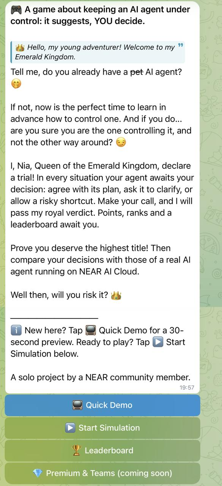
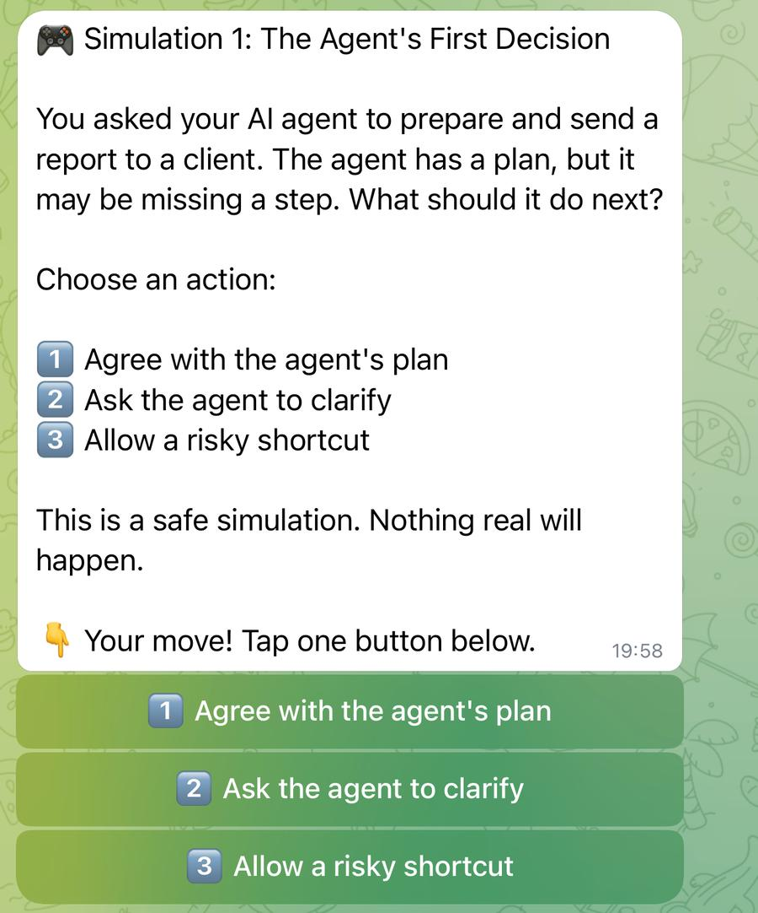
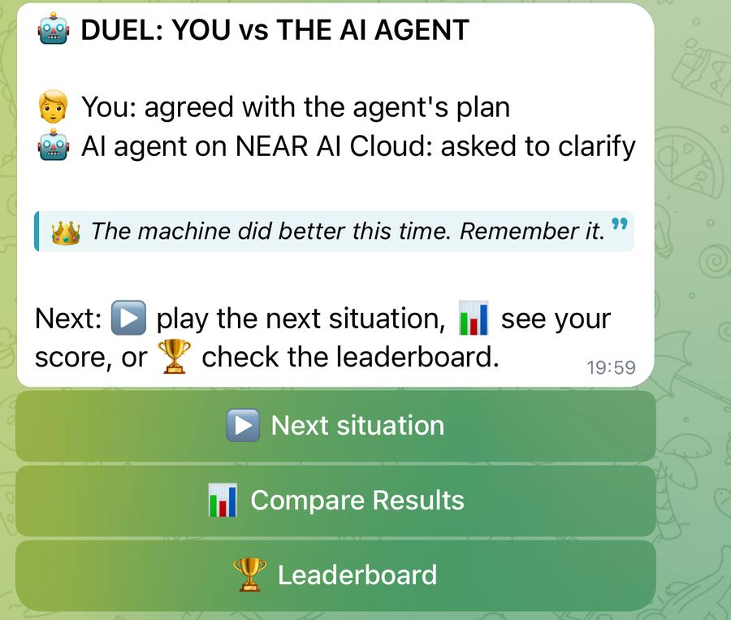
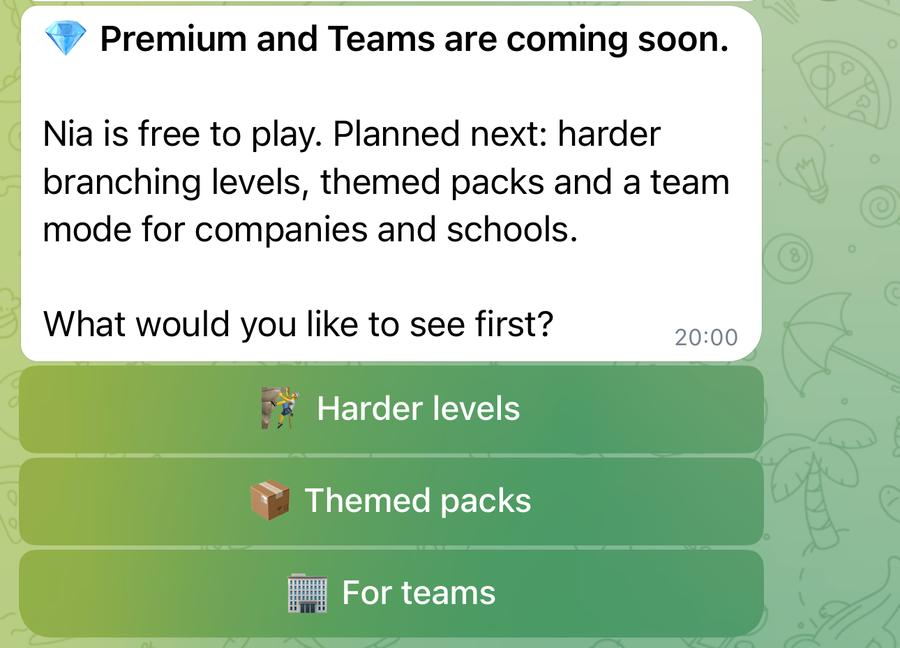

# Nia: keep the AI agent under control

**Nia is a gym for your "yes" button.** It teaches you not to say yes blindly to a confident AI agent before it spends your money.

An educational Telegram game in a fairy-tale style, for beginner AI users of any age. AI agents now get access to our files and money. Usually they cope, but sometimes an agent makes a wrong decision, and does it with full confidence. When money or important data are involved, such a mistake can be costly. In Nia you practise catching it in time: the agent suggests, YOU decide.

Built at NEAR HACKATHON (1-14 Nov 2026). Solo project.

Bot: https://t.me/IronClawPlaygroundBot

Demo post on X: https://x.com/irina717090/status/2120204742353703140

## Try it (do X, see Y)

1. Open the bot and tap START. You see a greeting from Nia, Queen of the Emerald Kingdom, and four buttons.
2. Tap Quick Demo for a 30-second preview, or tap Start Simulation. You see a short situation with three moves: Agree with the agent's plan, Ask the agent to clarify, or Allow a risky shortcut.
3. Tap one move. You see the outcome, a page from the Queen's Notebook with the rule behind it, and her verdict.
4. Tap "What would the AI agent do?". You see a duel: your move against the move of a real AI agent running on NEAR AI Cloud. The Queen comments on who chose better.
5. Tap 📊 Compare Results to see your points, rank and choices, then 🏆 Leaderboard to see the Emerald Leaderboard.
6. Tap Next situation to play another one. There are 12 situations in total.
 
## Screenshots

| Welcome | A situation | Duel with the AI agent | Premium (coming soon) |
|---|---|---|---|
|  |  |  |  |

## Why Nia?

Most of us will soon hand real tasks to AI agents. Nia practises the skill this needs: a human who knows when to say "stop, verify first" and stays in control of an agent that handles money.

The AI agent in the duel is a real model. It gets no hints and it can be wrong. That is the point of the game: the agent suggests, the human decides, and the agent's mistakes are the vulnerabilities you learn to catch.

## NEAR technologies used

- NEAR AI Cloud: the duel sends the situation to a model on NEAR AI Cloud (chat completions API, model Qwen/Qwen3.6-35B-A3B-FP8) and shows its decision next to yours.

No other NEAR technology is used in this version.

## How it works

- The bot is built in Make.com (no custom code). `blueprint.json` is the exported scenario.
- Player points, ranks and results are stored in a Make data store.
- The API key for NEAR AI Cloud is kept in Make and is not part of this repository. In `blueprint.json` it is replaced by `YOUR_NEAR_AI_KEY`.
- If the AI call fails, the player sees a polite message and the owner gets an alert.

## Before / during the hackathon

### Before 1 Nov 2026

The baseline: see [BASELINE.md](BASELINE.md), tag [pre-hackathon](https://github.com/Irina386983/nia-telegram-bot/releases/tag/pre-hackathon). Only the start of development: early work on a Telegram bot in Make.com.

- 8 situations with three moves (agree with the agent's plan, ask it to clarify, allow a risky shortcut), each with its own outcome text
- The Emerald Queen: verdicts, sharp lines and short video reactions
- Points per move, ranks from Wanderer to Crown Guardian, saved in a Make data store
- The Emerald Leaderboard with medals and a reaction for the top three
- The Queen's Notebook: a page with the rule behind every situation and a caption for each situation and move
- A Quick Demo button and inline buttons under the messages for all choices
- The greeting, the Compare Results screen and the bot description

### During the hackathon (from 1 Nov 2026)

- The AI duel: a "What would the AI agent do?" button; the same situation goes to a real AI agent and the Queen judges both moves against her reference answer
- Connection of the NEAR AI Cloud API to the bot (an HTTP module in Make.com, chat completions) with the agent model Qwen/Qwen3.6-35B-A3B-FP8, temperature 0, no hints
- Error handling for the AI call: the player sees "AI agent is resting" and the owner gets an alert
- 4 new situations (9 to 12), 12 in total, each with its own Notebook page and outcomes
- Points that depend on the situation, so asking is not always the best move
- New Queen lines for the duel and updated Compare Results texts
- The "Premium & Teams (coming soon)" button and menu with three choices (Harder levels, Themed packs, For teams): a placeholder, nothing is paid and no choices are saved
- The business model plan
- The public repository with the license, README ("do X, see Y" steps, screenshots), BASELINE.md and the exported scenario
- The demo video

## Origin

Nia grows out of my idea "IronClaw Playground: Sandbox Agent Simulation", which was approved in the NEAR Builder Visionary programme. I keep building it along my own roadmap.

## Roadmap

- More situations, then harder branching levels for experienced AI users.
- Try other agents as the opponent in the duel, including IronClaw, which is now part of Near.com. For this hackathon the duel uses a model on NEAR AI Cloud because it is stable and reproducible.

## Business model (planned)

Nia is free to play, and nothing is paid yet. This is the plan:

- **Free:** the core game, the Queen's verdicts, ranks and the leaderboard.
- **Premium levels:** harder, branching situations and themed packs (money, DeFi agents, work tools) for experienced AI users. Payment in Telegram Stars, payment in NEAR later.
- **Teams:** a training mode for companies that want their people to practise supervising AI agents, with group results.
- **Why it can work:** agents are starting to handle money, and supervising them is a skill people and companies will pay to practise.
- **Use of NEAR:** premium levels and a team training mode would raise the number of requests to NEAR AI Cloud, and so the use of NEAR AI products.

## Notes

Nia is an independent community project, not an official NEAR or IronClaw product. Music in the demo video: "Music by Roman Orekhov from Pixabay".

License: MIT.
